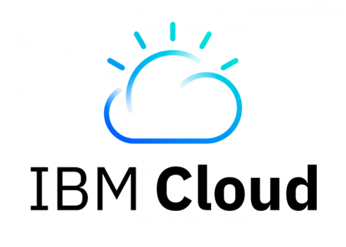
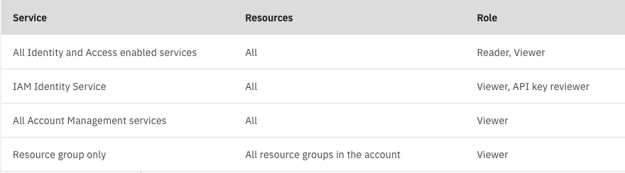
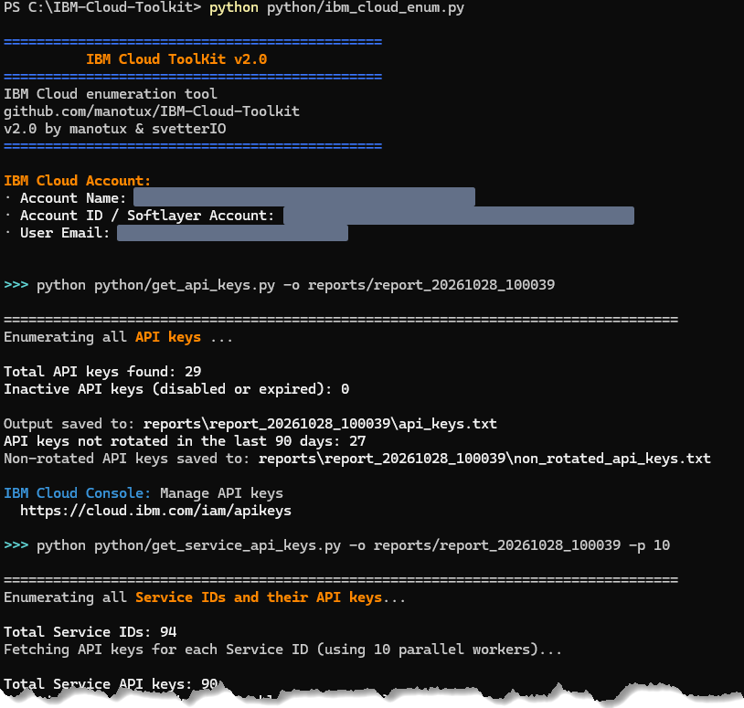

<h1 align="center"></h1>

# IBM Cloud ToolKit
A collection of scripts for enumeration of IBM Cloud resources and identification of weak security settings.
Available as **Bash** (Linux/macOS) and **Python 3** (Linux, macOS, Windows).

## Why was this project created?

This toolkit is intended to automate the enumeration of resources and security settings during penetration testing engagements on IBM Cloud accounts. Manual enumeration is time consuming, repetitive, tedious and prone to human error, especially when dealing with complex cloud environments. This collection of scripts aims to improve efficiency, and ensure more accurate coverage of IBM Cloud assets and configurations.

While there are several well-established open-source tools for major cloud providers like AWS and Azure, there are very few similar initiatives focused on IBM Cloud. This project was created to help fill that gap and provide the IBM Cloud community with tools for security assessments and resource inventory.

Contributions and community feedback are welcome! If you find these scripts useful, have suggestions for improvements, feature requests, or want to contribute in any way, feel free to open an issue or submit a PR.

---

## Repository Layout

```
IBM-Cloud-Toolkit/
├── bash/           Bash modules, utils.sh, ibm_cloud_enum.sh
├── python/         Python modules, utils.py, ibm_cloud_enum.py
├── reports/        Offline HTML report viewer (reports/index.html)
│                   Run folders (reports/report_YYYYMMDD_HHMMSS/) are git-ignored
├── install/        IBM Cloud CLI installers (Bash, PowerShell, Python)
├── docs/           Porting guides, pentest observation templates, test plans
│   └── images/     README images
├── requirements.txt
├── LICENSE
└── README.md
```

---

## Prerequisites

### Permissions
Required permissions may vary depending on the services being audited. At minimum, reader/viewer privileges should be assigned:



### Bash implementation
- **IBM Cloud CLI** – see [Installation](#ibm-cloud-cli-installation) below
- **jq** – lightweight command-line JSON processor
- **Bash 4.3 or later** – on macOS, install Homebrew's Bash and ensure it is in your `PATH`
- Authenticated session via `ibmcloud login`

### Python implementation
- **Python 3.8+**
- **IBM Cloud CLI** – the Python scripts call the CLI for authentication and plugin commands
- Authenticated session via `ibmcloud login`
- No external Python packages required (standard library only)

---

## IBM Cloud CLI Installation

### Linux / macOS

Use the provided script to install the CLI and all required plugins:

```bash
bash install/install_ibmcloud_cli.sh
```

Or install manually:

```bash
# macOS
curl -fsSL https://clis.cloud.ibm.com/install/osx | sh

# Linux
curl -fsSL https://clis.cloud.ibm.com/install/linux | sh
```

### Windows

Use the provided PowerShell script:

```powershell
powershell -ExecutionPolicy Bypass -File install\install_ibmcloud_cli.ps1
```

Or download the installer directly from the [IBM Cloud CLI releases page](https://github.com/IBM-Cloud/ibm-cloud-cli-release/releases).

### Cross-platform (Python)

```bash
python install/install_ibmcloud_cli.py   # Linux/macOS
python install\install_ibmcloud_cli.py   # Windows
```

### Plugin Installation

After installing the CLI, install the required plugins:

```bash
ibmcloud plugin install cloud-databases
ibmcloud plugin install vpc-infrastructure
ibmcloud plugin install schematics
ibmcloud plugin install cloud-object-storage
ibmcloud plugin install container-registry
ibmcloud plugin install ks
ibmcloud plugin install sl
ibmcloud plugin install code-engine
```

---

## Python Setup

### Linux / macOS

```bash
python3 -m venv venv
source venv/bin/activate
python3 -m pip install -r requirements.txt
```

### Windows (PowerShell)

```powershell
python -m venv venv
.\venv\Scripts\Activate.ps1
python -m pip install -r requirements.txt
```

### Windows (cmd)

```cmd
python -m venv venv
venv\Scripts\activate.bat
python -m pip install -r requirements.txt
```

> **Note:** The Python implementation uses only the standard library. `requirements.txt` is provided for tooling compatibility; no packages need to be installed for normal use.

---

## Quick Start



### Bash (Linux / macOS)

```bash
bash/ibm_cloud_enum.sh
```

### Python

```bash
# Linux / macOS
python3 python/ibm_cloud_enum.py

# Windows
python python\ibm_cloud_enum.py
```

---

## Output (reports) directory

The Python runner (`ibm_cloud_enum.py`) writes every run into a **time-bound folder inside `reports/`**, e.g. `reports/report_20261026_082939`, so runs never overwrite each other. Use `-o OUTPUT_DIR` to choose a different path.

`reports/*` is listed in `.gitignore` with a `!reports/index.html` exception, so the report viewer is always committed but run folders (which contain client data) never are.

---

## HTML Report (Offline SPA)

[`reports/index.html`](reports/index.html) is a fully self-contained single-page application in the IBM Carbon design style. It needs **no web server, no internet access, and no build step** — just open the file in your browser.

### Loading data

- Click **Select folder** (or drag and drop the `reports/` folder onto the page).
- All `report_YYYYMMDD_HHMMSS` run folders inside are discovered automatically; the latest run is selected by default.
- A dropdown lets you switch between runs. Legacy `output_YYYYMMDD_HHMMSS` folders are also recognised for backwards compatibility.
- All data is read locally in the browser. A strict Content-Security-Policy (`default-src 'none'`) blocks every network request — no data ever leaves your machine.

### Tables

- Filterable (text search) and sortable by any column.
- Date columns offer **from / until** date pickers (UTC, both days inclusive).
- Tag columns (e.g. Status, Key exposed) use word-boundary matching so searching `active` finds `Active` but not `Inactive`.
- Secret columns (e.g. API key values) are masked in a read-only password field with an eye-button reveal. Secret values are never included in the text filter, sorting, or any copy format.

### Copying

- **Copy table as** — opens a panel with:
  - **Column picker**: toggle checkboxes to include or exclude individual columns from the copy.
  - **Format**: Plain text, Markdown, Excel (tab-separated), Word (formatted HTML table).
- **Copy unique `<IDs>`** — copies de-duplicated values of one column (e.g. all unique API key IDs).
- All copy operations honour the active filter and sort order.

### UI

- **Dark mode** switch (IBM Carbon Gray 100 theme). Choice is persisted in `localStorage`; defaults to OS preference.
- Fully keyboard-accessible with visible focus rings, `aria-*` attributes, and `prefers-reduced-motion` support.
- Responsive below 672 px.

### Currently registered modules

| Module | Sections | Key fields |
|---|---|---|
| **API keys** (`get_api_keys`) | All keys · Non-rotated (>90 days) | ID, Name, Created at, Created by, Status |
| **Service API keys** (`get_service_api_keys`) | All keys · Exposed keys · Non-rotated (>90 days) | Service name/ID, Key name/ID, Created at, Status, Locked, Key exposed, Console link, API key (masked) |

---

## Usage

Each script accepts a `-h` flag for usage information. Example for `get_api_keys`:

```
$ python3 python/get_api_keys.py -h
usage: get_api_keys.py [-h] [-o OUTPUT_DIR] [-f OUTPUT_FILE] [-d ROTATION_DAYS] [-v]

Enumerate IBM Cloud API keys and flag non-rotated ones.

options:
  -h            show this help message and exit
  -o OUTPUT_DIR  Report folder (default: 'reports')
  -f OUTPUT_FILE Output file name (default: 'api_keys.txt')
  -d ROTATION_DAYS  Rotation threshold in days (default: 90)
  -v            Enable debug output
```

---

## Scripts

The Bash and Python versions expose the same options and produce the same output files.

#### - [ibm_cloud_enum](bash/ibm_cloud_enum.sh) / [ibm_cloud_enum.py](python/ibm_cloud_enum.py)
Executes all enumeration scripts against the IBM Cloud Account.

#### - [get_custom_roles](bash/get_custom_roles.sh) / [get_custom_roles.py](python/get_custom_roles.py)
Enumerates custom IAM roles to be verified for excessive privileges granted to users.

#### - [get_users](bash/get_users.sh) / [get_users.py](python/get_users.py)
Enumerates existing users and identifies any with state different than ACTIVE.

#### - [get_user_policies](bash/get_user_policies.sh) / [get_user_policies.py](python/get_user_policies.py)
Identifies users with access policies assigned directly (not via groups).

#### - [get_api_keys](bash/get_api_keys.sh) / [get_api_keys.py](python/get_api_keys.py)
Enumerates existing API Keys and identifies those not rotated within a configurable period (default: 90 days).

#### - [get_mfa](bash/get_mfa.sh) / [get_mfa.py](python/get_mfa.py)
Retrieves the IBM Cloud account identity settings and determines the MFA requirement status.

#### - [get_regions](bash/get_regions.sh) / [get_regions.py](python/get_regions.py)
Enumerates enabled regions on the IBM Cloud account.

#### - [get_floating_IPs](bash/get_floating_IPs.sh) / [get_floating_IPs.py](python/get_floating_IPs.py)
Enumerates all floating IPs in each enabled IBM Cloud region.

#### - [get_VSIs](bash/get_VSIs.sh) / [get_VSIs.py](python/get_VSIs.py)
Enumerates all VSIs (IBM Cloud VMs) in each enabled IBM Cloud region. Also generates a separate file for VSIs with metadata enabled.

#### - [get_buckets](bash/get_buckets.sh) / [get_buckets.py](python/get_buckets.py)
Enumerates all IBM Cloud Object Storage buckets in the account.

#### - [get_buckets_files](bash/get_buckets_files.sh) / [get_buckets_files.py](python/get_buckets_files.py)
Lists all files in existing IBM Cloud Object Storage buckets. **Note:** Disabled for automatic execution in the runner scripts due to potentially long execution times. Run manually.

#### - [download_buckets_files](bash/download_buckets_files.sh) / [download_buckets_files.py](python/download_buckets_files.py)
Downloads files from all IBM Cloud Object Storage buckets. Supports flattening and overwrite options.

#### - [get_schematics](bash/get_schematics.sh) / [get_schematics.py](python/get_schematics.py)
Enumerates all IBM Cloud Schematics workspaces in each enabled region. Output can be reviewed with [TruffleHog](https://github.com/trufflesecurity/trufflehog) or [detect-secrets](https://github.com/Yelp/detect-secrets) to identify secrets stored in variables.

#### - [get_clusters](bash/get_clusters.sh) / [get_clusters.py](python/get_clusters.py)
Enumerates all IBM Cloud Kubernetes/Openshift clusters. Also generates a separate file for clusters with public endpoint enabled.

#### - [get_databases](bash/get_databases.sh) / [get_databases.py](python/get_databases.py)
Enumerates all IBM Cloud Databases (Cloud Databases, DB2 and Cloudant). Also generates a separate file for databases with public endpoint enabled, including their public endpoints (`hostname:port`).

#### - [get_security_groups](bash/get_security_groups.sh) / [get_security_groups.py](python/get_security_groups.py)
Enumerates all IBM Cloud VPC security groups and identifies overly permissive inbound rules.

#### - [get_load_balancers](bash/get_load_balancers.sh) / [get_load_balancers.py](python/get_load_balancers.py)
Enumerates all IBM Cloud VPC Load Balancers in each enabled region, with their listeners, pools and subnets. Also generates a separate file for public load balancers, including their public endpoints (`hostname:port`).

#### - [get_code_engine](bash/get_code_engine.sh) / [get_code_engine.py](python/get_code_engine.py)
Enumerates all IBM Cloud Code Engine projects. For each project, retrieves Applications (including environment variables and public endpoint status), Functions, ConfigMaps, and Secrets.

#### - [get_service_api_keys](python/get_service_api_keys.py) *(Python only)*
Enumerates all Service IDs and their associated API keys. Detects keys whose plaintext value is returned by the IAM API (exposed/leaked keys) and flags keys not rotated within a configurable threshold (default: 90 days). Verbose (`-v`) mode shows per-key debug lines with IBM Cloud CLI commands; full-debug (`-d`) appends the exact `ibmcloud iam service-api-keys` command for each key.

#### - [get_container_registry](python/get_container_registry.py) *(Python only)*
Enumerates IBM Cloud Container Registry namespaces, images, and settings. Flags images with known vulnerabilities reported by Vulnerability Advisor and images that have not been scanned.

#### - [get_my_access](python/get_my_access.py) *(Python only)*
Enumerates the access capabilities of the identity currently logged in to the IBM Cloud CLI (user, service ID or trusted profile): identity details decoded from the IAM token, direct access policies, and the policies of all access groups the identity belongs to.

#### - [search_buckets_file_names](python/search_buckets_file_names.py) *(Python only, opt-in)*
Scans all Cloud Object Storage bucket file keys for names that suggest sensitive content (passwords, credentials, API keys, certificates, etc.). Run with `-s` flag in the full runner or independently. Results include instance name, bucket, region, full object key, and matched keywords.

---

## Installers

| File | Platform | Description |
|------|----------|-------------|
| [install/install_ibmcloud_cli.sh](install/install_ibmcloud_cli.sh) | Linux / macOS | Bash installer with plugin support |
| [install/install_ibmcloud_cli.ps1](install/install_ibmcloud_cli.ps1) | Windows | PowerShell installer with plugin support |
| [install/install_ibmcloud_cli.py](install/install_ibmcloud_cli.py) | All | Python cross-platform installer |

---

## Recent Changes

### Version 2.0

#### Python implementation
- Full Python 3.8+ implementation of every Bash module — works on Linux, macOS, and Windows without `jq` or `curl`.
- Single entry-point runner `python/ibm_cloud_enum.py` executes all modules sequentially or a single named module (`python ibm_cloud_enum.py get_api_keys`).
- Two-phase argument parser: runner-level flags (`-o`, `-v`, `-d`) are consumed by the runner; all remaining flags are forwarded as-is to the target module, preventing flag collisions.
- Time-bound output folders: every full run writes to `reports/report_YYYYMMDD_HHMMSS/` automatically so runs never overwrite each other.

#### New Python-only modules
- **`get_service_api_keys`** — enumerates Service IDs and their API keys; detects exposed (leaked) plaintext key values and non-rotated keys; verbose mode shows per-key CLI commands with leak warnings in red; full-debug mode appends the exact `ibmcloud iam service-api-keys` replay command for every key.
- **`get_container_registry`** — enumerates Container Registry namespaces and images; flags CVE-affected images via Vulnerability Advisor.
- **`get_my_access`** — decodes the current IAM token identity, lists direct access policies, and enumerates access group memberships and their policies.
- **`search_buckets_file_names`** — scans COS bucket object keys for names suggesting sensitive content (credentials, certificates, API keys); opt-in via `-s` in the full runner.

#### Offline HTML report viewer (`reports/index.html`)
A fully self-contained single-page application (no server, no CDN, no build step) in the IBM Carbon design style.
- **Data loading**: folder picker (`<input webkitdirectory>`) and drag-and-drop; auto-discovers all `report_*` run folders; `report_*` and legacy `output_*` both recognised.
- **Multi-run support**: dropdown to switch between runs; latest run selected automatically.
- **Tables**: sortable headers, text filter with word-boundary matching for tag columns, date-range filter (UTC) for timestamp columns.
- **Secret columns**: API key values masked in read-only password fields; eye-button reveal; value excluded from all filters, sorting, and copy formats.
- **Copy table as**: opens a two-section panel — column picker (per-column checkboxes, all on by default; format buttons disabled when nothing is checked) and four copy formats: Plain text, Markdown, Excel (tab-separated), Word (formatted HTML table).
- **Copy unique IDs**: de-duplicates a chosen column and copies the result with a count toast.
- **Dark mode**: IBM Carbon Gray 100; persisted in `localStorage`; defaults to OS preference.
- **Security**: `default-src 'none'` CSP; DOM built with a safe `el()` helper (no `innerHTML` for data); keyboard accessible; `prefers-reduced-motion`; responsive.
- **gitignore**: `reports/*` with `!reports/index.html` — viewer is always tracked; run folders (client data) are never committed.

#### Repository layout
- Bash scripts → `bash/`, Python scripts → `python/`, installers → `install/`, images → `docs/images/`.
- Cross-platform installers: `install/install_ibmcloud_cli.ps1` (Windows PowerShell) and `install/install_ibmcloud_cli.py` (cross-platform Python).
- Line-ending config: `.gitattributes` (LF for `.sh`/`.py`, CRLF for `.ps1`) and `.editorconfig`.
- `docs/` expanded with porting guide, pentest observation templates, and test plans.

### Version 1.2
- **CLI-Based Authentication**: Removed IBMCLOUD_API_KEY environment variable requirement. Access tokens are now retrieved directly from authenticated IBM Cloud CLI sessions (`ibmcloud login`), supporting environments where API key creation is restricted.
- **Kubernetes Clusters**: Added ingress subdomain retrieval.
- **Debug Mode**: Added two-level debug modes across enumeration scripts, safe `-v` flag for commands and progress visibility with token-redacted output, and `-d` for full debug.
- **Parallel Processing**: Performance improvements via parallel API requests in some scripts.
- **Resource Statistics**: Display totals and statistics for all resources (e.g., total users, buckets, VSIs).
- **JSON Validation**: Validate all API responses and graceful error handling.
- **Enhanced Output**: List resources on stdout with organized formatting while detailed results are saved to output files.

### Version 1.1
- **IBM Account Identity Settings**: Retrieves IBM Cloud account identity settings.
- **MFA Requirement**: Verifies whether MFA is enforced at the account level and detects any user-specific MFA configurations.
- **DB2 Database**: Adds support for identifying IBM Cloud DB2 database instances.
- **Code Engine**: Enumerates IBM Cloud Code Engine projects.
- **Security Groups**: Enumerates security groups and flags overly permissive rules.
- **Execution Change**: `get_buckets_files.sh` is now disabled in `ibm_cloud_enum.sh` and must be executed manually.

---

## TODO
- Support for handling multiple IBM Cloud accounts in batch mode across all enumeration scripts.
- Implement pagination support in all modules.

---

## Author
Heber Blain Gonçalves

- [linkedin.com/hebergoncalves/](https://linkedin.com/in/hebergoncalves/)
- [github.com/manotux](https://github.com/manotux)

## Co-Author (v2.0 Python implementation)
Sebastian Vetter

- [linkedin.com/in/svetterio](https://www.linkedin.com/in/svetterio)
- [github.com/svetterIO](https://github.com/svetterIO)

## License
This project is licensed under the MIT License. See the [LICENSE](LICENSE) file for details.

## Disclaimer

This project is a personal and community-driven initiative and is not affiliated with, endorsed by, or supported by IBM or IBM Cloud. IBM and IBM Cloud are not responsible for this project or any outcomes resulting from its use.

This software is provided as-is, with no guarantees. Use it at your own risk. The author and contributors are not responsible for any problems, data loss, or damage that may happen.
